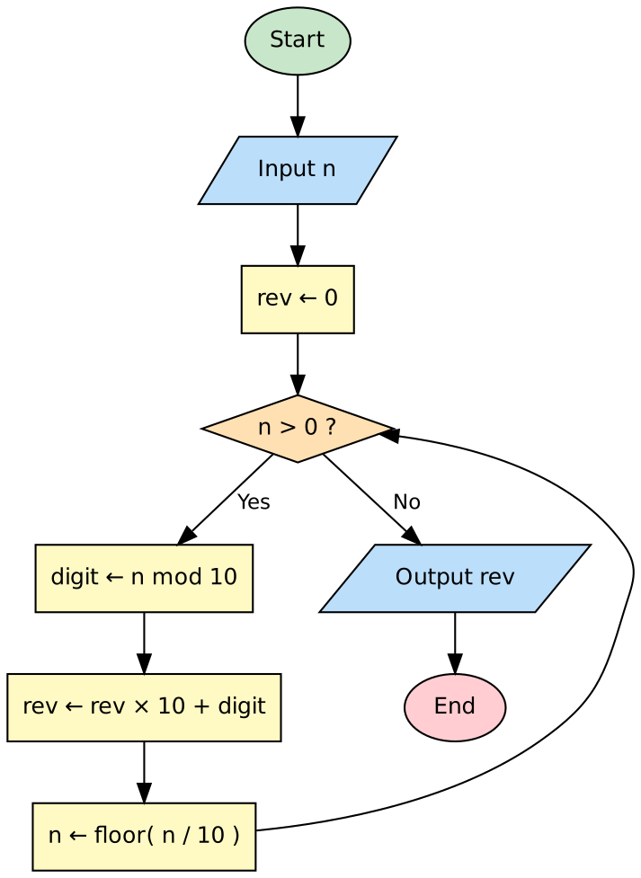

# Q1 - RAPTOR Flowchart: Reverse a Number
**CO2 | CO1 | 25 marks**

Reverses the digits of a positive integer (1234 -> 4321). Useful for numeric palindrome checks, because a palindrome equals its own reverse.

| File | Purpose |
|---|---|
| `flowchart.png / .svg / .dot / .mmd` | The flowchart (Graphviz render + Mermaid source) |
| `reverse_number.py` | Same algorithm in code, with a loop trace |
| `test_reverse_number.py` | Unit tests (`python -m unittest -v`) |
| `sample-runs.txt` | Real output for 1234, 98765, 1200 |
| `screenshots/` | **Put your RAPTOR screenshots here** |

---

## Part A - Design and Implementation (15 marks)

### 1. Flowchart


### 2. Build it in RAPTOR (the `.rap` file must be made in the RAPTOR app)
| # | RAPTOR symbol | Content |
|---|---|---|
| 1 | Input (parallelogram) | Prompt: `Enter a positive integer`, Variable: `n` |
| 2 | Assignment | `rev <- 0` |
| 3 | Loop | Condition `n = 0` (RAPTOR's loop **exits when the condition is true**, which is the same as running while `n > 0`) |
| 4 | Assignment (in loop) | `digit <- n mod 10` |
| 5 | Assignment (in loop) | `rev <- rev * 10 + digit` |
| 6 | Assignment (in loop) | `n <- floor(n / 10)` |
| 7 | Output (after loop) | `"Reversed number: " + rev` |

Save as `reverse_number.rap`, run it (Run > Execute to End / Play) and capture the master console output.

### 3. Executions (inputs and outputs)
| Input | Output | Screenshot |
|---|---|---|
| 1234 | 4321 | `screenshots/run-1234.png` |
| 98765 | 56789 | `screenshots/run-98765.png` |
| 1200 | 21 | `screenshots/run-1200.png` |

The same results come from the Python version:
```
$ python reverse_number.py 1234
Input : 1234
iter | n (before) | digit |      rev | n (after)
   1 |       1234 |     4 |        4 |       123
   2 |        123 |     3 |       43 |        12
   3 |         12 |     2 |      432 |         1
   4 |          1 |     1 |     4321 |         0
Output: 4321
```

---

## Part B - Analysis (10 marks)

### Trace for n = 1234 (initial `rev = 0`)
| Iteration | n (start) | Test `n > 0` | digit = n mod 10 | rev = rev x 10 + digit | n = floor(n/10) |
|---|---|---|---|---|---|
| 1 | 1234 | true | 4 | 0x10 + 4 = **4** | 123 |
| 2 | 123 | true | 3 | 4x10 + 3 = **43** | 12 |
| 3 | 12 | true | 2 | 43x10 + 2 = **432** | 1 |
| 4 | 1 | true | 1 | 432x10 + 1 = **4321** | 0 |
| exit | 0 | false | - | - | - |

Output: `rev = 4321`.

### Time complexity
- The loop removes one digit per pass, so it runs **d** times, where d is the number of digits of n.
- d = floor(log10 n) + 1, so the time complexity is **O(d) = O(log n)**.
- Each pass does a constant amount of work (one mod, one multiply, one add, one division), and only three variables are used, so the space is **O(1)**.

### Trailing zeros, n = 1200
| Iteration | n (start) | digit | rev | n (after) |
|---|---|---|---|---|
| 1 | 1200 | 0 | 0 | 120 |
| 2 | 120 | 0 | 0 | 12 |
| 3 | 12 | 2 | 2 | 1 |
| 4 | 1 | 1 | 21 | 0 |

The output is **21**, not 0021. The two trailing zeros are processed first, and while `rev` is still 0 the update `rev x 10 + 0` keeps it at 0, so they vanish. An integer cannot store leading zeros. To keep them, treat the input as a string (or count the zeros and append them as text).
