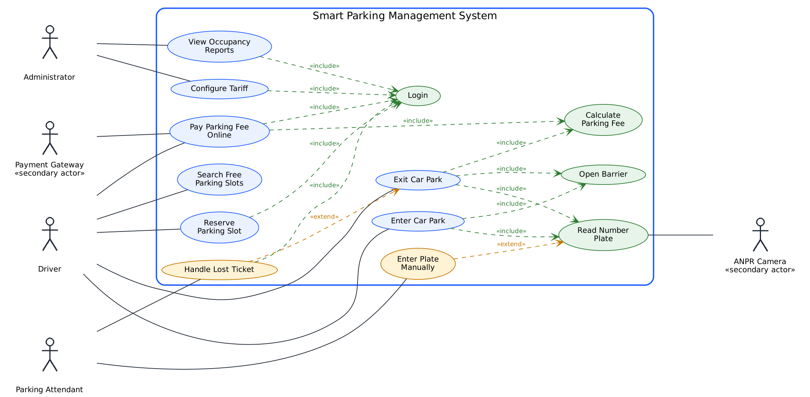

# Q4 - Smart Parking Management System: UML Use Case Diagram
**CO5 | CO1 | 25 marks**

Scenario: a shopping-mall parking system. Drivers search free slots, reserve a slot in advance and pay the parking fee online. At entry and exit gates a camera reads the number plate to open the barrier. The parking attendant handles exceptions such as a lost ticket. The administrator configures the tariff and views occupancy reports.

| File | Purpose |
|---|---|
| `smart-parking-use-case.png` / `.svg` | The diagram (rendered with Graphviz from `smart-parking.dot`) |
| `smart-parking.puml` | PlantUML source: **paste into a CASE tool and screenshot it** (see below) |
| `smart-parking.dot`, `actor.png` | Graphviz source and stick-figure icon (`dot -Tpng smart-parking.dot -o out.png`) |
| `screenshots/` | **Put your CASE-tool screenshot here** |

> If your instructor wants a specific CASE tool, open `smart-parking.puml` in it (PlantUML web server, StarUML, Visual Paradigm, or draw.io via *Arrange > Insert > Advanced > PlantUML*) and submit that screenshot. The model is identical.

---

## Part A - Design and Implementation (15 marks)

### 1. Actors
| Actor | Type | Role |
|---|---|---|
| Driver | Primary | Searches slots, reserves, pays, enters and exits |
| Parking Attendant | Primary | Handles exceptions: lost ticket, unreadable plate |
| Administrator | Primary | Sets the tariff, views occupancy reports |
| ANPR Camera | Secondary (external system) | Reads the number plate at the gates |
| Payment Gateway | Secondary (external system) | Processes online payments |

### 2. System boundary
The rectangle **Smart Parking Management System**. The actors and the physical camera/payment services are outside it; everything the software does is inside.

### 3. Use cases
| Use case | Actor | Description |
|---|---|---|
| Search Free Parking Slots | Driver | Shows free slots by level and zone |
| Reserve Parking Slot | Driver | Books a slot for a time window |
| Pay Parking Fee Online | Driver, Payment Gateway | Pays the computed fee in advance |
| Enter Car Park | Driver, (camera via Read Number Plate) | Vehicle is identified and the barrier opens |
| Exit Car Park | Driver, (camera via Read Number Plate) | Fee is verified and the barrier opens |
| Handle Lost Ticket | Parking Attendant | Resolves an exit when the ticket is lost |
| Enter Plate Manually | Parking Attendant | Types the plate when the camera cannot read it |
| Configure Tariff | Administrator | Sets hourly rates, daily cap, lost-ticket fee |
| View Occupancy Reports | Administrator | Occupancy and revenue by day or month |
| Login | (shared) | Authenticates a user |
| Read Number Plate | ANPR Camera | Captures and recognises the plate |
| Open Barrier | (system) | Raises the barrier arm |
| Calculate Parking Fee | (system) | Computes the fee from duration and tariff |

### 4. Relationships
| Relationship | From -> To | Meaning |
|---|---|---|
| `<<include>>` | Reserve, Pay, Handle Lost Ticket, Configure Tariff, View Reports -> **Login** | Authentication is always required first |
| `<<include>>` | Pay, Exit -> **Calculate Parking Fee** | The fee is always computed |
| `<<include>>` | Enter, Exit -> **Read Number Plate** | The vehicle is always identified |
| `<<include>>` | Enter, Exit -> **Open Barrier** | The barrier always opens at the end |
| `<<extend>>` | **Handle Lost Ticket** -> Exit Car Park | Only when the ticket is lost |
| `<<extend>>` | **Enter Plate Manually** -> Read Number Plate | Only when the camera fails to read |

Notation reminders: the `<<include>>` arrow points from the base use case to the included one. The `<<extend>>` arrow points from the extending use case to the base.

---

## Part B - Analysis (10 marks)

### Why each include or extend was used
**Include** is used when the behaviour is **mandatory** every time the base use case runs, and is **reused** by more than one use case.
- *Login* is needed by five use cases. Drawing it once avoids repeating the same steps, and changing authentication (for example adding OTP) is done in one place.
- *Calculate Parking Fee* is shared by Pay Online and Exit; both must give the same amount.
- *Read Number Plate* and *Open Barrier* are fixed steps of both entering and exiting. Neither Enter nor Exit can complete without them.

**Extend** is used when the behaviour is **optional or conditional** and the base use case is complete without it.
- *Handle Lost Ticket* only runs for the rare case where the ticket is missing. Normal exits never touch it.
- *Enter Plate Manually* only runs when the camera fails (dirty plate, glare). Normal reads never touch it.
- In both cases the base use case does not depend on the extension, which is the test for choosing extend instead of include.

### How "Lost Ticket" relates to the Exit process
Exit Car Park normally goes: read plate -> find entry time -> calculate fee -> confirm payment -> open barrier. If the driver has lost the ticket, the system cannot confirm the entry record or the fee at the verification step, so the exit is blocked. That is the **extension point**. The attendant runs *Handle Lost Ticket*: verify the driver's identity and vehicle, look up the entry record from the plate log (or apply the lost-ticket fee set by the administrator in Configure Tariff), take payment, and authorise the exit. Control then **returns to Exit Car Park**, which finishes by opening the barrier. Lost Ticket is therefore not a separate journey; it is a conditional detour inside Exit, which is why it is an `<<extend>>` of Exit Car Park and not an `<<include>>`.

### Which use cases need the driver to be logged in
| Needs login | Why |
|---|---|
| **Reserve Parking Slot** | The reservation belongs to an account and its payment details |
| **Pay Parking Fee Online** | Payment must be tied to a verified user and receipt |

| No login needed | Why |
|---|---|
| Search Free Parking Slots | Public information, no personal data; fewer barriers for visitors |
| Enter Car Park / Exit Car Park | The vehicle is identified by its **number plate at the gate**; drivers cannot be expected to log in at a barrier |

The staff use cases (Configure Tariff, View Occupancy Reports, Handle Lost Ticket) also include Login, as the administrator and attendant must be authenticated before acting on tariffs, reports or exceptions.
